<div align="center">

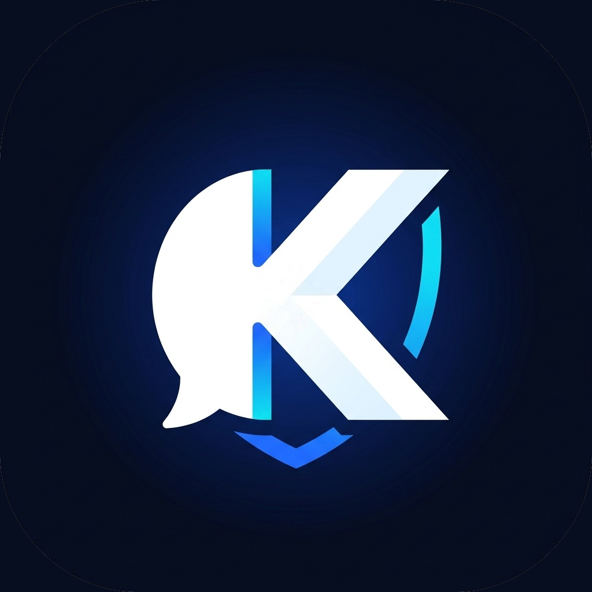

# K Chat: Make Messaging Smarter

### Real-Time Communication × Context Intelligence × Modern Android

<p>
  <a href="https://play.google.com/store/apps/details?id=com.kunal.kchat">
    
  </a>
  <a href="https://github.com/programmer-kunal/KChat">
    
  </a>
</p>

<p>
  
  
  
  
</p>

<p>
  
  
  
  
</p>

**Don't just deliver the conversation. Understand the conversation.**

K Chat combines real-time direct and group messaging, multimedia sharing, voice/video calling, and contextual AI tools in a modern Android application.

</div>

---

## Table of Contents

- [Overview](#-overview)
- [Core Communication](#-core-communication)
- [K Chat AI](#-k-chat-ai)
  - [Smart Reply](#-smart-reply)
  - [Thread Summary](#-thread-summary)
  - [Context Search](#-context-search)
  - [Scam Guard](#-scam-guard)
- [K Chat Extension](#-k-chat-extension)
- [Media and Attachments](#-media-and-attachments)
- [Encryption and Privacy](#-encryption-and-privacy)
- [Architecture](#-architecture)
- [Technology Stack](#-technology-stack)
- [Security and Responsible AI](#-security-and-responsible-ai)
- [Screenshots](#-screenshots)
- [Build from Source](#-build-from-source)
- [Verification and Release Notes](#-verification-and-release-notes)
- [Developer](#-developer)

---

## 🌟 Overview

Traditional messaging generally follows this pattern:

```text
Send → Receive → Reply
```

K Chat adds context-aware assistance to the communication flow:

```text
Send → Understand → Assist → Communicate
```

Conversations may contain decisions, tasks, deadlines, questions, important details, and potential security risks. K Chat brings communication and selected AI assistance together so users can work with that context without leaving the conversation.

### Highlights

- Real-time one-to-one and group messaging.
- Voice and video calling through ZEGOCLOUD.
- Image, audio, video, and document sharing.
- Delivery/read information, quoted replies, conversation previews, and unread counters.
- **K Chat Extension**, a convenient in-chat surface for opening communication tools and AI actions.
- Four user-triggered AI features: Smart Reply, Thread Summary, Context Search, and Scam Guard.
- Client-side encryption for supported newly sent private messages and private media flows.
- Local-first chat rendering to help make navigation smoother.

---

## 💬 Core Communication

K Chat provides the foundations for everyday private and group conversations:

- 🔐 Firebase Authentication.
- 💬 One-to-one messaging.
- 👥 Group chat and member management.
- 👤 Friend discovery, requests, and user profiles.
- 🟢 Online/offline presence and last-seen information.
- ✅ Delivery and read/seen receipts, with message information views.
- ↩️ Swipe-to-reply and quoted replies.
- 🧭 Conversation previews and unread counters.
- 🔔 Push notifications for supported message events.
- 📞 Voice calls and 📹 video calls.
- ⚡ Local-first rendering/cache for smoother chat navigation.

---

## 🧠 K Chat AI

K Chat includes four distinct, user-triggered AI features. Each feature has its own purpose and should be understood separately rather than as one combined capability.

<div align="center">

| Feature | What it does | Screenshot |
|---|---|---|
| **🤖 Smart Reply** | Suggests context-aware replies to selected messages. | 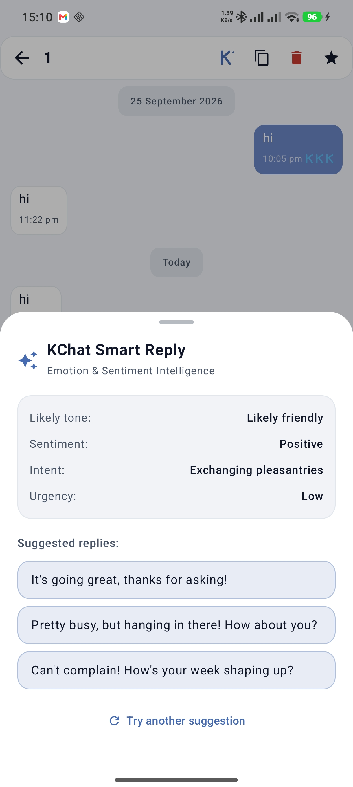 |
| **📝 Thread Summary** | Summarizes important points from a selected conversation. | 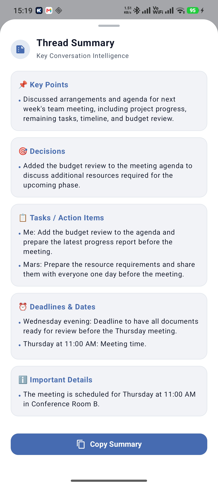 |
| **🔎 Context Search** | Helps find messages relevant to a natural-language question. | 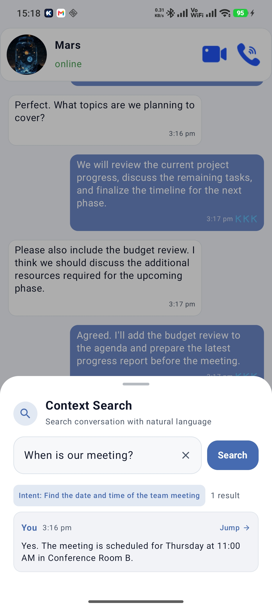 |
| **🛡️ Scam Guard** | Highlights potential scam or phishing indicators in a selected message. | 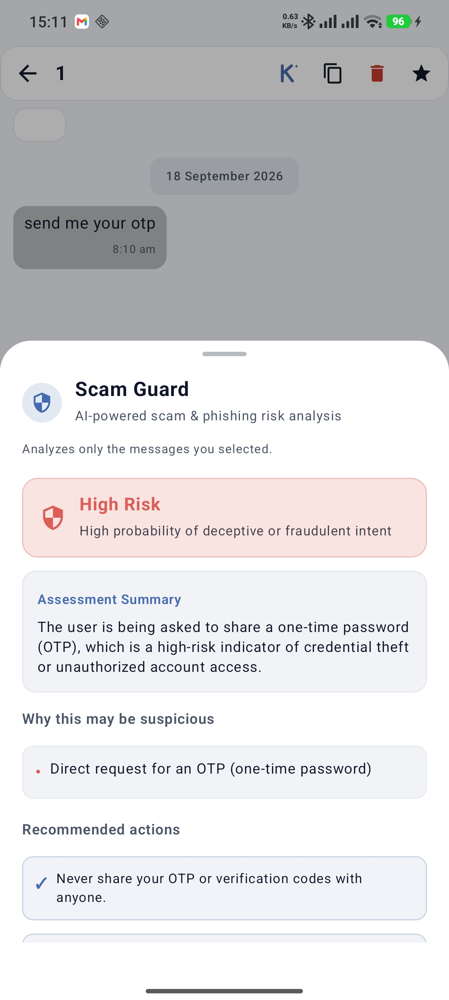 |

</div>

### 🤖 Smart Reply

Smart Reply is an on-demand assistant for one-to-one conversations. It considers the selected messages and their available conversation context to generate suggested responses.

It can consider signals such as:

- **Tone** — the style or emotional register of the conversation.
- **Sentiment** — the apparent emotional direction of the selected content.
- **Intent** — what the message appears to ask or communicate.
- **Urgency** — whether the content appears time-sensitive.
- **Conversation context** — nearby selected messages relevant to the reply.

**Workflow**

```text
User selects messages
        ↓
Opens Smart Reply
        ↓
Firebase AI Logic / configured Gemini model
        ↓
Suggested replies
        ↓
User reviews or edits
        ↓
User sends manually
```

**Human-in-the-loop:** K Chat does not automatically send AI-generated replies. The user remains responsible for reviewing and sending a suggestion.

### 📝 Thread Summary

Thread Summary helps users catch up on a long conversation without manually rereading every message. It can organize the selected context into concise points such as:

- 📌 Key points.
- ✅ Decisions.
- 📝 Tasks or follow-ups.
- 📅 Deadlines.
- ⭐ Important details.

The summary is intended to help the user review the conversation more quickly; it should be checked against the original messages when accuracy is important.

### 🔎 Context Search

Context Search helps users retrieve relevant information from conversation context. Rather than depending only on exact keyword matches, users can ask a natural-language question, for example:

- “When do we need to complete the project?”
- “Who was responsible for the presentation?”
- “What decision did we make about the meeting?”

**Workflow**

```text
User enters a question
        ↓
Relevant conversation context is prepared
        ↓
AI analysis
        ↓
Relevant message results
        ↓
User reviews results and can jump to an original message
```

<div align="center">

<table>
  <tr>
    <td align="center">
      
      <br/><sub>Context Search</sub>
    </td>
    <td align="center">
      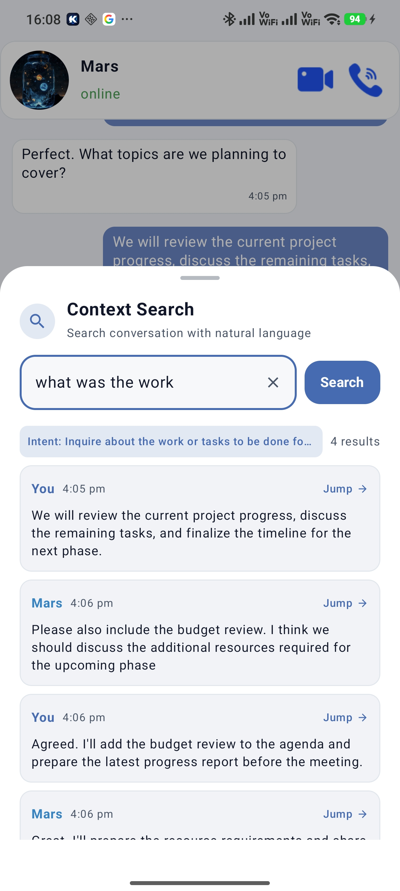
      <br/><sub>Search Results</sub>
    </td>
  </tr>
</table>

</div>

### 🛡️ Scam Guard

Scam Guard provides AI-assisted analysis of a message selected by the user. It can highlight warning signs that may be associated with suspicious communication, including:

- Suspicious links.
- Urgent or pressure-driven requests.
- Requests for credentials or verification codes.
- Unusual financial requests.
- Phishing patterns.
- Possible impersonation tactics.

**Workflow**

```text
User selects a message
        ↓
Opens Scam Guard
        ↓
AI-assisted risk analysis
        ↓
Risk indicators and explanation
        ↓
Recommendations for the user to consider
```

Scam Guard is an assistance feature, not a guarantee that a message is safe or malicious. Users should independently verify suspicious requests and links.

### AI Feature Comparison

| AI feature | Main input | Main output | Intended use |
|---|---|---|---|
| Smart Reply | Selected messages and relevant context | Suggested replies | Help compose a response |
| Thread Summary | Selected conversation context | Concise summary, decisions, tasks, and dates where available | Catch up on a conversation |
| Context Search | Natural-language question and relevant context | Related messages or information | Find something discussed earlier |
| Scam Guard | User-selected message | Potential risk indicators and recommendations | Support scam awareness |

All four AI features are user-triggered. Their outputs are suggestions and can be incomplete or incorrect; users should apply their own judgment.

---

## 🧩 K Chat Extension

**K Chat Extension lets users apply K Chat's four AI features to conversation content they choose to bring into K Chat—even when that content comes from another platform.** For example, users can copy messages from WhatsApp, Instagram, Telegram, or another app and provide that content to the extension for analysis.

The extension offers three ways to supply content:

- **Paste Messages:** paste copied chat messages or conversation text.
- **Screenshots:** add screenshots of a conversation for supported text extraction and analysis.
- **Import Text:** bring in conversation text from a supported text source.

When recognizable conversation text is supplied, the extension can display parsing information such as the number of messages and participants detected. The user can then choose which AI feature to apply to the supplied content.

### Extension workflow

```text
Copy, capture, or import conversation content
                     ↓
              Open K Chat Extension
                     ↓
       Paste Messages / Screenshots / Import Text
                     ↓
        Review the supplied conversation content
                     ↓
          Choose one of the four AI features
                     ↓
        View the result and copy it if needed
```

### Use the four AI tools beyond a single chat app

- **Smart Reply:** generate possible replies based on the supplied messages and context. Suggested replies can be copied individually, or the displayed result can be copied where supported.
- **Thread Summary:** turn supplied conversation content into a concise overview of key points, decisions, tasks, or deadlines where available.
- **Context Search:** ask a question about the supplied content to find relevant information.
- **Scam Guard:** examine a supplied message for potential phishing, fraud, or scam warning signs.

### K Chat Extension screenshots

The screenshots below show the extension's input methods, feature selection, and example results.

<div align="center">

| K Chat Extension — content input and feature selection | K Chat Extension — Smart Reply result |
|---|---|
| 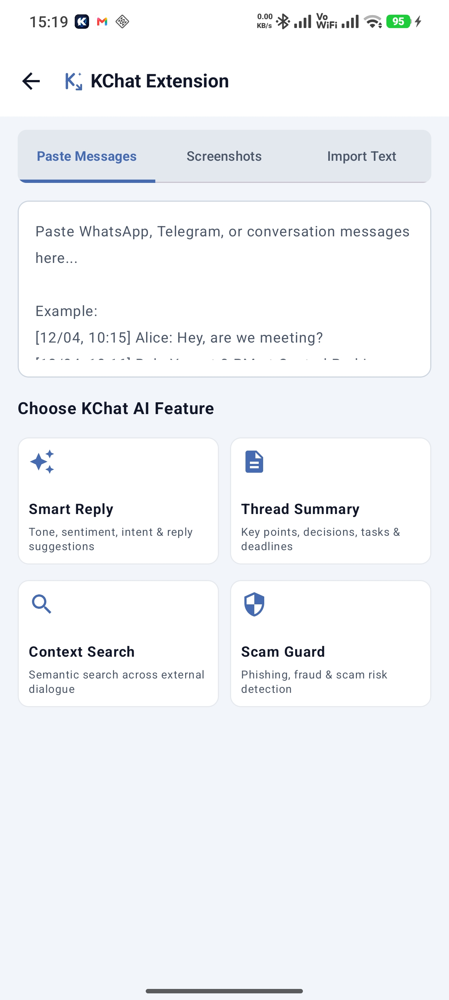 | 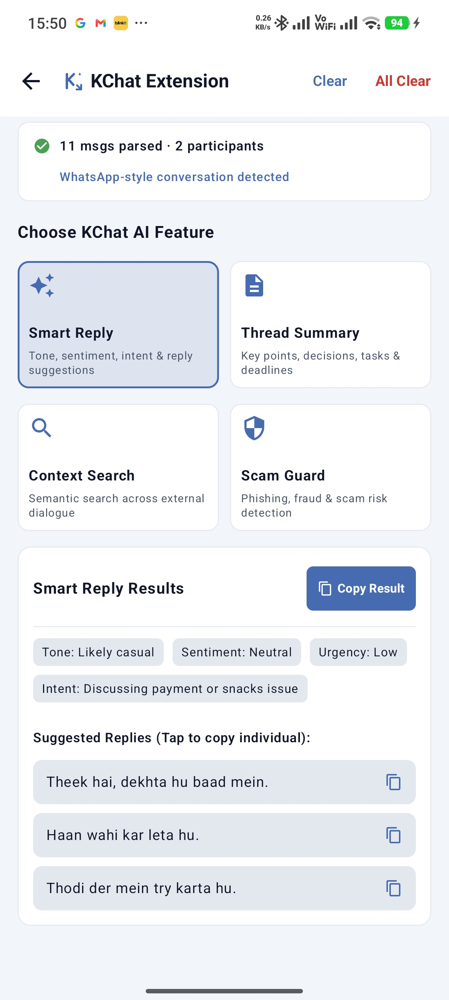 |

| K Chat Extension — Smart Reply | K Chat Extension — Thread Summary |
|---|---|
| 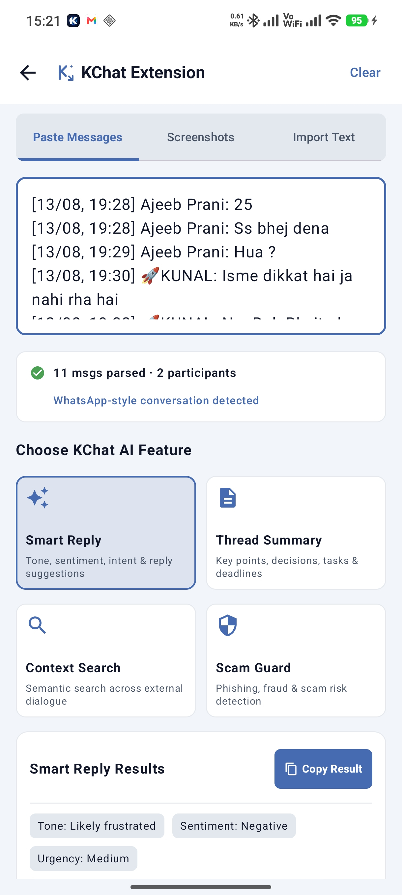 | 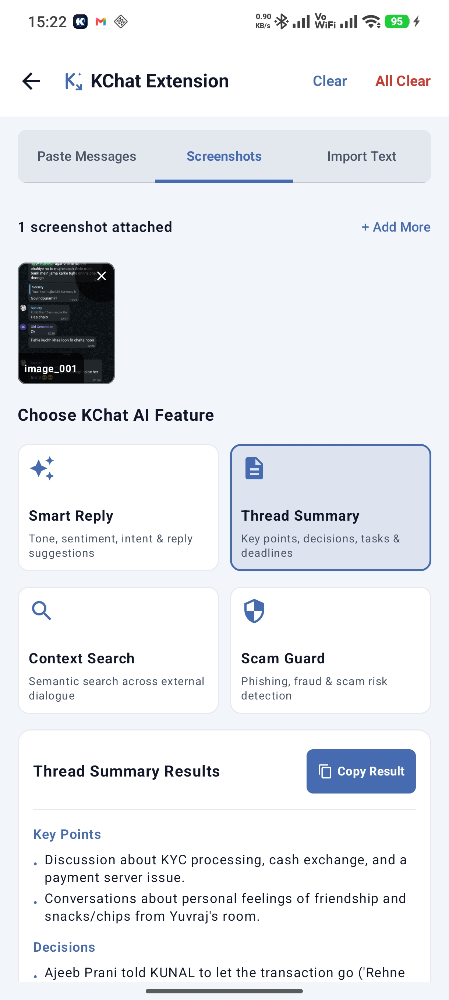 |

</div>

### What makes the extension useful?

- **Cross-app workflow:** users can bring in messages copied from other apps instead of limiting every AI task to a conversation stored in K Chat.
- **Multiple input methods:** users can paste text, provide screenshots, or import text through the available tabs.
- **Four distinct tools in one place:** users select the feature that matches their need rather than receiving one generic AI response.
- **User-controlled results:** generated suggestions, summaries, search results, and risk indicators are presented for the user to review. Smart Reply does not automatically send a message into the source app.

**Important:** K Chat Extension works with the content that the user provides. It does not silently read all messages or automatically access the private conversation history of WhatsApp, Instagram, or other third-party apps. AI output may be incomplete or incorrect and should be reviewed before use.

---

## 📎 Media and Attachments

K Chat supports sharing and handling of the following media types:

- 📷 Images.
- 🎤 Voice messages.
- 🎥 Video messages.
- 📄 Documents and other supported files.

Private media flows support client-side encryption before remote storage where configured. On receipt, authorized users can download, decrypt locally, and open or play supported media. Documents may open through an Android viewer compatible with the file type.

---

## 🔐 Encryption and Privacy

K Chat implements client-side encryption for supported newly sent private direct and group messages, alongside encryption support for private media. The precise scope matters: historical content, notification previews, and AI processing do not necessarily follow the same encryption path.

### Protected message flow

```text
Sender composes a supported private message
        ↓
Client-side AES-GCM encryption using Google Tink
        ↓
Message key is wrapped for active recipient devices
(HPKE / X25519 key wrapping)
        ↓
Encrypted payload and key envelopes are stored with chat data
        ↓
Recipient retrieves the encrypted message
        ↓
Recipient device unwraps the key and decrypts locally
```

For group conversations, the implementation includes group key distribution and sender-key/epoch handling. Device identity signing and protection of HPKE private keys use Android Keystore-backed mechanisms where implemented.

### Private media

- 🔒 Supported private media is encrypted on the client before storage.
- 🗄️ Supabase Storage is used for media storage; protected media access uses the application's authenticated or signed service flow where configured.
- 📎 Image, audio, video, and document flows support encrypted transfer, local decryption, and opening/playback for authorized recipients where implemented.
- 🧹 Decrypted temporary files are managed separately from encrypted remote objects.

### Scope and compatibility notes

- Encryption applies to supported newly sent private messages/media. Historical legacy messages are not automatically migrated or re-encrypted.
- If a device's local private key is lost—for example, after uninstalling the app—content encrypted only for that device key may not be recoverable unless another supported recipient/device key path is available.
- Push-notification previews use a separate delivery path and are **not covered by the encrypted message-payload path**. E2EE for stored message payloads should not be interpreted as a claim that notification previews are end-to-end encrypted.
- User-triggered AI features process the context provided to the configured Firebase AI Logic/Gemini flow. This AI request path is distinct from encrypted message storage.
- AI-generated suggestions are shown to the user for review; K Chat does not automatically send an AI-generated reply.

These notes distinguish implemented protections from legacy compatibility and separate service paths. They are not a claim that every historical message, notification, or AI request has identical encryption properties.

---

## 🏗️ Architecture

K Chat uses a modular Android architecture built around Jetpack Compose, MVVM, Kotlin coroutines/Flow, Firebase, Supabase, Firebase AI Logic, and ZEGOCLOUD.

<div align="center">

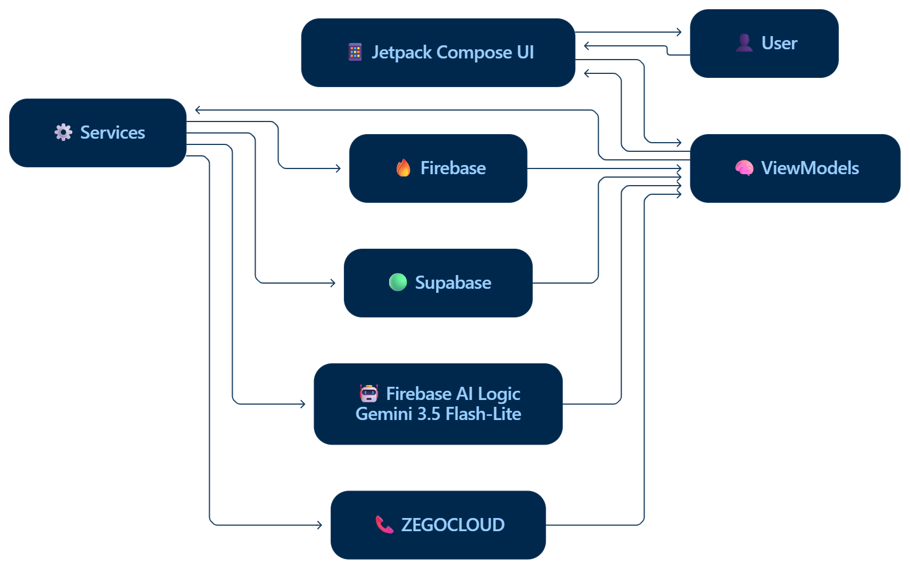

<br/><sub>Application Architecture</sub>

</div>

### Main layers

| Layer | Responsibility |
|---|---|
| Compose UI | Chat, media, attachment, extension, and AI interfaces |
| ViewModels | Screen state and application logic |
| Communication services | Messaging, presence, notifications, and calling integration |
| Firebase Authentication | User authentication |
| Firebase Realtime Database | Real-time message and application data |
| Firebase Cloud Messaging | Push notification delivery |
| Supabase Storage | Media/file storage, including protected media flows where configured |
| Firebase AI Logic + configured Gemini model | User-triggered AI processing |
| Google Tink + HPKE/X25519 + Android Keystore | Encryption and device-key protection for supported flows |
| Local-first cache | Fast rendering and bounded in-memory caching of recent chats |
| ZEGOCLOUD | Voice/video calling integration |

### AI architecture

The AI flow begins with a user action and selected or relevant conversation context.

<div align="center">

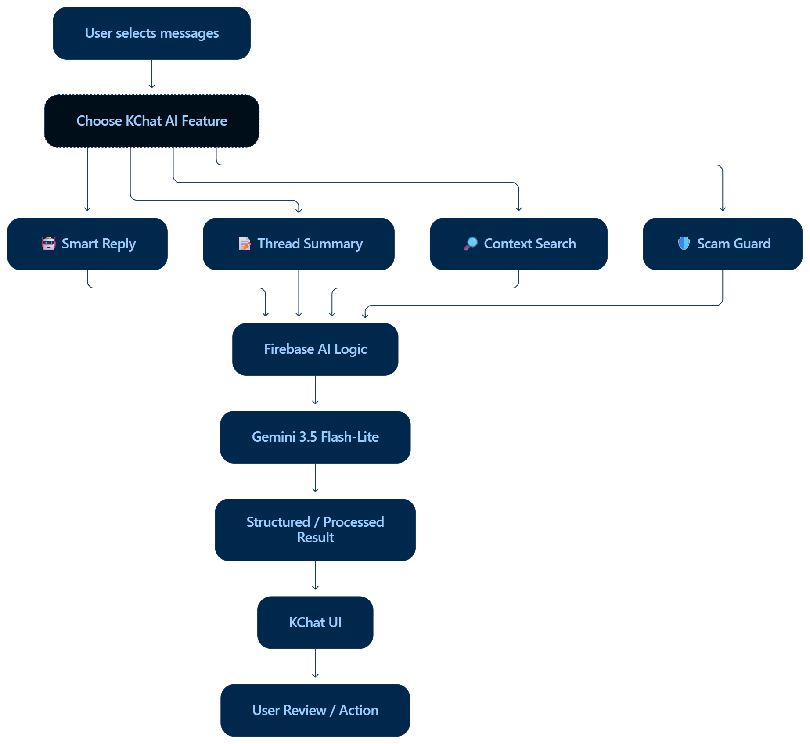

<br/><sub>Context Intelligence Architecture</sub>

</div>

```text
User
  ↓
Selects messages or enters a question
  ↓
Chooses an AI feature
  ├── Smart Reply
  ├── Thread Summary
  ├── Context Search
  └── Scam Guard
          ↓
Firebase AI Logic / configured Gemini model
          ↓
AI result displayed in K Chat
          ↓
User reviews and decides what to do
```

---

## 🛠️ Technology Stack

| Layer | Technologies |
|---|---|
| Platform | Android |
| Language | Kotlin |
| UI | Jetpack Compose + Material 3 |
| Architecture | MVVM, Kotlin Coroutines, Flow / StateFlow |
| Authentication | Firebase Authentication |
| Database | Firebase Realtime Database |
| Notifications | Firebase Cloud Messaging |
| AI | Firebase AI Logic + configured Gemini model |
| Media storage | Supabase Storage |
| Calling | ZEGOCLOUD |
| Image loading | Coil |
| Dependency injection | Hilt |
| Encryption | Google Tink AES-GCM, HPKE/X25519 key wrapping, Android Keystore-backed key protection where implemented |
| App protection | Firebase App Check + reCAPTCHA Enterprise, as configured |
| Build | Gradle + R8 |
| Version control | Git + GitHub |

---

## 🛡️ Security and Responsible AI

K Chat combines application access controls, protected device-key handling, encryption for supported private message/media flows, and a user-controlled AI workflow.

```text
AI suggests
   ↓
User reviews
   ↓
User edits if needed
   ↓
User decides
   ↓
User performs the action
```

### Security principles

- ✅ AI features are user-triggered.
- ✅ AI does not automatically send messages.
- ✅ No continuous background AI scanning is intended by these user-triggered features.
- ✅ No Gemini developer API key is intended to be embedded in the application; AI access uses the configured Firebase AI Logic integration.
- ✅ Firebase App Check and reCAPTCHA Enterprise are configured for app protection.
- ✅ Public profile data and private account/device data use separated storage paths where configured.
- ✅ Firebase device-record deserialization has explicit compatibility and R8 keep-rule handling for Release builds.
- ✅ Supported newly sent private message payloads and private media use client-side encryption.
- ⚠️ Push-notification previews are separate from the E2EE payload path.
- ⚠️ Historical legacy content is not automatically re-encrypted; loss of device keys can affect historical decryption.
- ✅ Users remain in control of AI invocation and message sending.

---

## 📸 Screenshots

<details>
<summary><strong>Authentication and user features</strong></summary>

<div align="center">

| Login | Profile | Add Friend | Friend Requests |
|---|---|---|---|
| 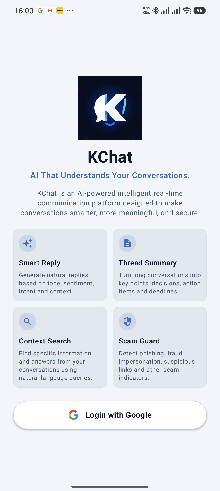 | 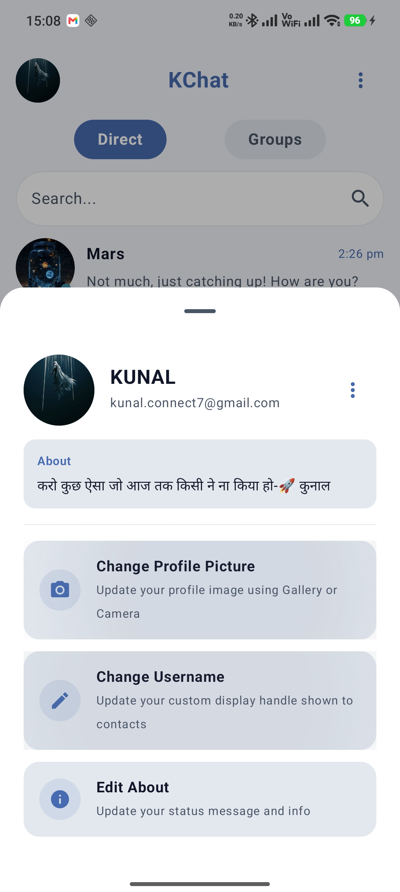 | 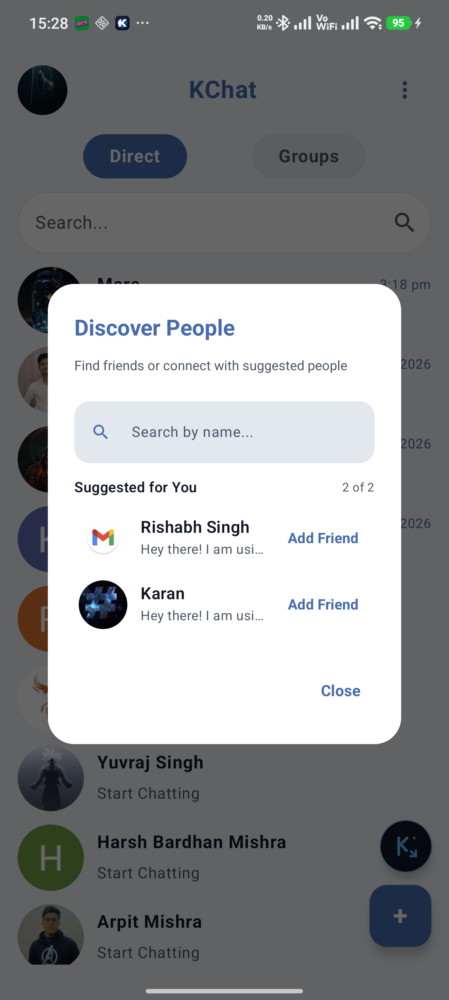 | 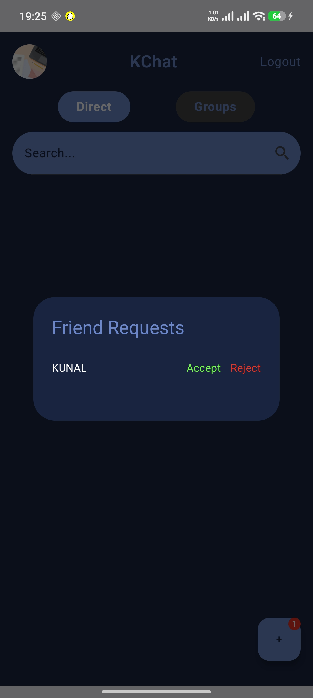 |

</div>

</details>

<details>
<summary><strong>Communication and chat</strong></summary>

<div align="center">

| Direct chat home | Conversation home | Personal chat | Chat interaction |
|---|---|---|---|
| 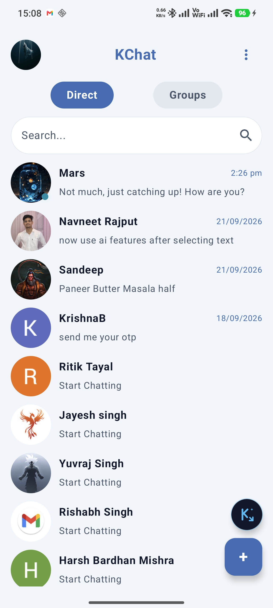 | 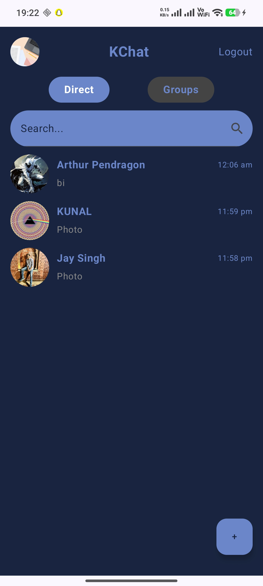 | 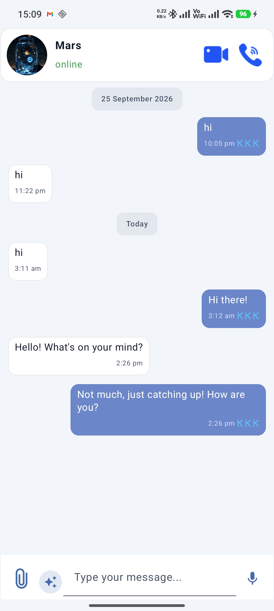 | 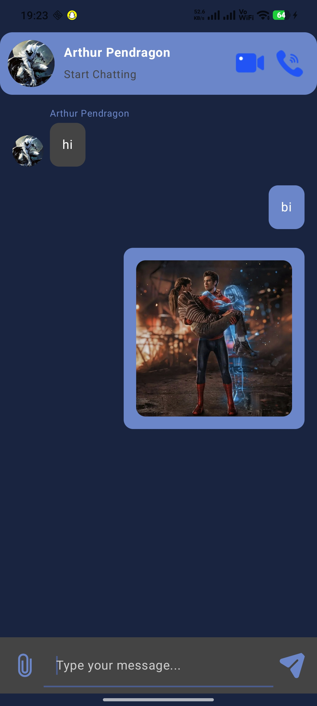 |

| Group chat | Attachments | K Chat AI | Smart Reply |
|---|---|---|---|
| 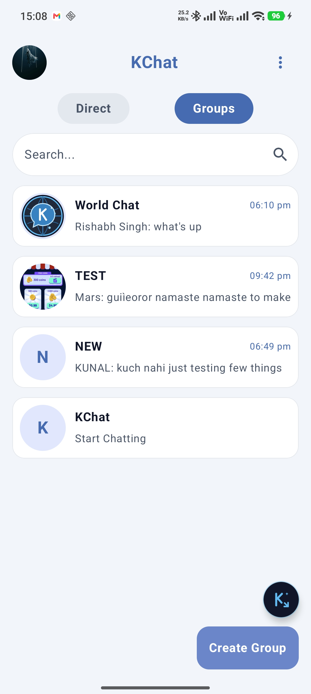 | 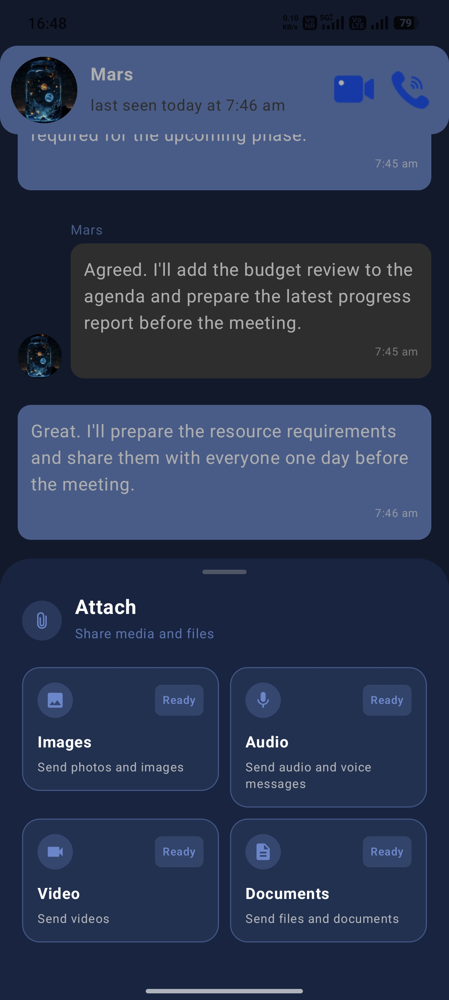 | 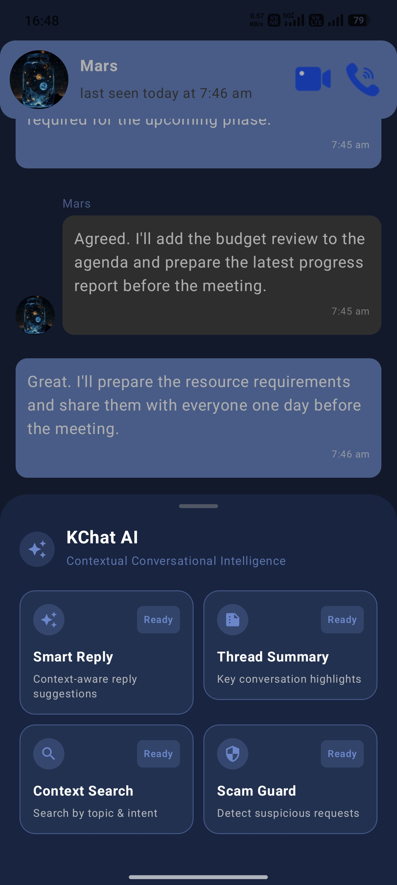 |  |

</div>

</details>

<details>
<summary><strong>AI features</strong></summary>

<div align="center">

| Thread Summary | Context Search | Search Results | Scam Guard |
|---|---|---|---|
|  |  |  |  |

</div>

</details>

---

## 📥 Get K Chat on Google Play

Install K Chat using its official Google Play listing. Availability and rollout of newer updates are controlled by Google Play.

<div align="center">

<a href="https://play.google.com/store/apps/details?id=com.kunal.kchat">
  
</a>

<p><a href="https://play.google.com/store/apps/details?id=com.kunal.kchat">https://play.google.com/store/apps/details?id=com.kunal.kchat</a></p>

</div>

---

## 🧾 Recent Engineering Updates

Recent implementation work has focused on the following areas:

- **Release stability:** Added Firebase Realtime Database deserialization support and R8 keep rules for `DeviceKeyManager.DeviceRecord` to prevent reflective model construction from failing in minified Release builds.
- **Encrypted messaging:** Added client-side encryption for supported newly sent private messages and key wrapping for active recipient devices; group conversations use their configured key-distribution flow.
- **Protected media:** Improved encrypted media handling for supported private images, audio, video, and documents, including authorized local decryption for playback/opening.
- **Message-state handling:** Improved delivery/read information, local chat caching, conversation-list previews, and unread-state behavior.
- **Calling and notifications:** Maintains the direct/group calling integration and the separate push-notification delivery path.
- **K Chat Extension:** Organizes access to in-chat tools and supported contextual assistance.

These engineering notes describe implementation areas and should not be treated as independent performance benchmarks or claims of perfect security. Consult the current Google Play listing for the publicly available release.

---

## 🛠️ Build from Source

### 1. Clone the repository

```bash
git clone https://github.com/programmer-kunal/KChat.git "K Chat"
cd "K Chat"
```

The GitHub repository is named `KChat`; the quoted destination folder creates the local workspace as `K Chat`.

### 2. Configure local properties

Create or update `local.properties` locally with the configuration expected by your project. For example:

```properties
ZEGO_APP_ID=your_zego_app_id
ZEGO_APP_SIGN=your_zego_app_sign

SUPABASE_URL=your_supabase_url
SUPABASE_ANON_KEY=your_supabase_anon_key

RECAPTCHA_ENTERPRISE_SITE_KEY=your_recaptcha_site_key
```

Use the exact variable names required by the current Gradle configuration. Values shown above are placeholders, not working credentials. Never place service-role keys or private server credentials in an Android client.

### 3. Add Firebase configuration

Place your project-specific `google-services.json` file here:

```text
app/google-services.json
```

Do not publish private service-account JSON files or other backend secrets.

### 4. Build a debug APK

On macOS/Linux:

```bash
./gradlew assembleDebug
```

On Windows PowerShell:

```powershell
.\gradlew.bat assembleDebug
```

### 5. Build a release APK

On macOS/Linux:

```bash
./gradlew assembleRelease
```

On Windows PowerShell:

```powershell
.\gradlew.bat assembleRelease
```

A production release also requires the project's appropriate local signing configuration. Do not commit signing keys, passwords, private keys, `local.properties`, real API secrets, or generated APK/AAB artifacts.

---

## ✅ Feature Status Overview

| Feature | Status / Notes |
|---|---|
| Firebase Authentication | Implemented |
| One-to-one messaging | Implemented |
| Group messaging | Implemented |
| Friend system and presence | Implemented |
| Delivery/read information | Implemented |
| Quoted replies | Implemented |
| Local-first chat rendering/cache | Implemented |
| Image, audio, video, and document sharing | Implemented; encrypted private-media support where configured |
| Direct and group calling | Integrated with ZEGOCLOUD |
| Push notifications | Implemented; notification preview path is separate from E2EE payload encryption |
| K Chat Extension | In-chat entry point for supported extension tools/contextual assistance |
| Smart Reply | User-triggered AI reply suggestions |
| Thread Summary | User-triggered conversation summarization |
| Context Search | Context-based conversation retrieval |
| Scam Guard | User-triggered risk-indicator analysis |
| Client-side encryption | Supported newly sent private text/media flows; see scope notes |
| Firebase device-record Release fix | Constructor compatibility and R8 keep rules included in the hotfix source |

Feature availability may depend on app version, configuration, account state, and backend/service availability.

---

## 🌟 The K Chat Vision

```text
MESSAGE
   ↓
CONTEXT
   ↓
INTELLIGENCE
   ↓
ASSISTANCE
```

**From chat to context.** K Chat is built around one idea:

> Don't just deliver the conversation. Understand the conversation.

---

## 👨‍💻 Developer

<div align="center">

<a href="https://github.com/programmer-kunal">
  
  <br/>
  <strong>KUNAL</strong>
</a>

<br/>

Android Developer • Application Builder

<a href="https://github.com/programmer-kunal">
  
</a>

</div>

---

<div align="center">


### K Chat: Make Messaging Smarter

**Real-Time Communication × Context Intelligence × Modern Android**

<sub>Built with Kotlin • Jetpack Compose • Firebase • Supabase • Gemini • ZEGOCLOUD</sub>

</div>
